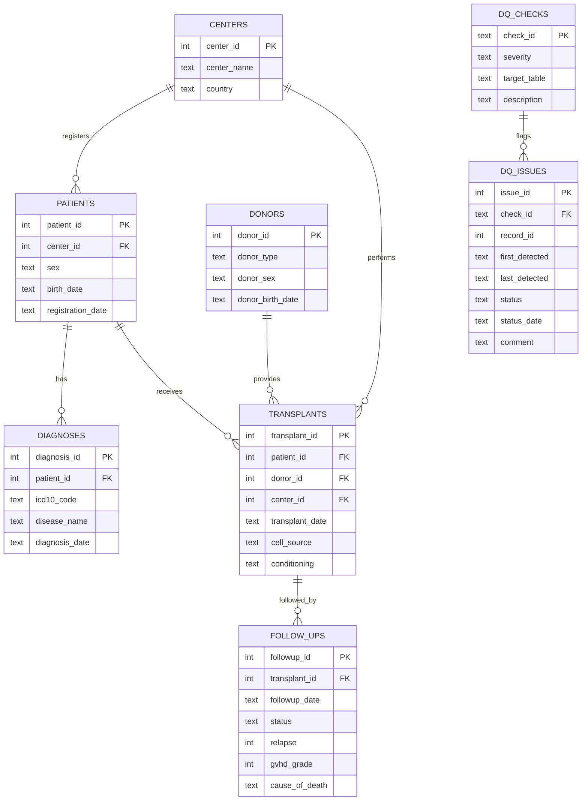

# Transplant registry SQL project

A relational database modelled on a haematopoietic stem cell transplant registry, with SQL queries, automated data quality checks, issue tracking for query management, and a mapping to the OMOP Common Data Model.

> **All data are synthetic.** They are generated by `generate_data.py` with a fixed random seed and do not describe real patients or real center activity. A small number of data errors are inserted on purpose so that the quality checks have something to find.

## Why this project

Clinical registries are only as useful as the data in them. Researchers and clinicians rely on registry data to study outcomes, so the data need a clear structure, consistent standards and continuous quality control.

I built this project to learn relational databases and SQL by working through the tasks that make registry data reliable:

1. **Designing a schema** that stores linked clinical information without duplication.
2. **Querying** the data to answer typical registry questions.
3. **Checking data quality**, including errors that only appear when values are compared across tables.
4. **Following up issues** with the reporting centers until they are corrected or confirmed.
5. **Mapping to a standard model** (OMOP CDM), so the data could be analysed alongside other sources.

## Design decisions

### A normalised schema

Registry data have natural one-to-many relationships. A center reports many patients, a patient can have more than one transplant, and each transplant has several follow-up visits. Storing everything in one flat table would repeat patient and center details on every row, and a correction would have to be made in many places.

The schema therefore splits the data into six linked tables. Each fact is stored once, and tables are connected through primary and foreign keys.



### Two layers of validation

Some errors can be rejected the moment data are entered. The schema uses `CHECK` constraints and foreign keys for these: sex must be M or F, a GvHD grade must be between 0 and 4, and a transplant cannot refer to a patient who does not exist.

Many real errors pass these rules, because each value is valid on its own and the problem only appears in combination. A transplant date is a valid date, but not if it falls before the diagnosis. These are caught by twelve checks in `queries/04_data_quality.sql`, which compare values across columns and tables:

| Check | Severity | Rule |
|---|---|---|
| DQ01 | high | Transplant dated before the diagnosis |
| DQ02 | high | Follow-up visit dated before its transplant |
| DQ03 | high | Birth date after registration date |
| DQ04 | high | Visit recorded as alive after a recorded death |
| DQ05 | medium | GvHD reported after an autologous transplant |
| DQ06 | medium | Possible duplicate patients (same center, sex and birth date) |
| DQ07 | medium | Death recorded without a cause |
| DQ08 | medium | Registered patient without any diagnosis |
| DQ09 | medium | Implausible age at transplant |
| DQ10 | low | Missing sex |
| DQ11 | low | Missing conditioning regimen |
| DQ12 | low | Missing GvHD grade after an allogeneic transplant |

Severity reflects the impact on analyses: impossible dates and contradictory outcomes are high, clinically implausible or incomplete key information is medium, and missing secondary fields are low.

Each check is a plain SQL query with a one-line header giving its ID, severity, target table and description. The Python report reads these headers, so the SQL file is the single place where checks are defined, and adding a new check means adding one query.

A flagged record is a candidate for review, not automatically an error. Two patients with the same center, sex and birth date may be genuinely different people, which is why the workflow below lets a center confirm a value as correct.

### Query management: tracking issues across campaigns

Finding problems is only half of the work. Each flagged record has to be sent to the reporting center as a query and followed until it is resolved. Checks are also run repeatedly, so the same issue must not be reported twice, and corrected records should be recognised automatically.

Every run of `dq_report.py` is treated as a data quality campaign and logs its results in the `dq_issues` table:

| Status | Meaning | Set by |
|---|---|---|
| `open` | Flagged, not yet sent to the center | `dq_report.py`, when a record is first flagged |
| `query_sent` | The center has been asked to verify the record | `update_issue.py` |
| `resolved` | The record was corrected | `dq_report.py`, when a check no longer flags it |
| `confirmed_correct` | The center confirmed the value is right | `update_issue.py` |

Each (check, record) pair is stored once, enforced by a `UNIQUE` constraint and written with an upsert (`INSERT ... ON CONFLICT`). A resolved issue is reopened if the problem returns, and a confirmed issue is not raised again. The result is an audit trail of when each issue was found, sent and resolved, which can be summarised per center (`queries/06_query_management.sql`).

### OMOP mapping through views

The OMOP Common Data Model lets different clinical databases be analysed with the same code. `queries/05_omop_views.sql` reshapes the registry into simplified versions of four OMOP tables (`person`, `condition_occurrence`, `procedure_occurrence` and `death`).

These are **views** rather than new tables, so the mapping is a layer on top of the registry. No data are copied, and any correction in the registry appears in the OMOP views immediately. Gender is mapped to the standard OMOP concepts (8507 male, 8532 female). Other concept IDs are deliberately left as 0 ("not yet mapped") rather than guessed, since a full mapping would translate ICD-10 codes to standard SNOMED CT concepts using the OHDSI Athena vocabularies.

### Simple and reproducible

The project uses SQLite and the Python standard library only, so it runs with no installation beyond Python. The data generator uses a fixed seed, so anyone running it gets the same database and the same results. SQLite has no dedicated date type, so dates are stored as ISO text (`YYYY-MM-DD`), which sorts and compares correctly and works with SQLite's date functions.

## Repository structure

| File | Purpose |
|---|---|
| `schema.sql` | Tables, keys, constraints, indexes and the `dq_issue_details` view |
| `generate_data.py` | Builds `registry.db` with synthetic data and deliberate errors |
| `queries/01_basics.sql` | Filtering, sorting, pattern matching, counting |
| `queries/02_joins.sql` | Inner and left joins across up to four tables, window functions |
| `queries/03_aggregations.sql` | Grouping, conditional counts, common table expressions |
| `queries/04_data_quality.sql` | The twelve data quality checks |
| `queries/05_omop_views.sql` | Mapping to a simplified OMOP CDM |
| `queries/06_query_management.sql` | Follow-up summaries: issues by status, per center, waiting times |
| `dq_report.py` | Runs a campaign, logs issues and writes `reports/data_quality_report.md` |
| `update_issue.py` | Lists issues and updates their status |
| `run_queries.py` | Runs any `.sql` file and prints the results |

## How to run

Requires Python 3.8 or later.

```bash
python generate_data.py                       # build registry.db
python run_queries.py queries/02_joins.sql    # run any query file
python dq_report.py                           # run a data quality campaign
```

A full query management cycle:

```bash
python dq_report.py --date 2026-01-10                    # campaign 1: all issues open
python update_issue.py --list                            # issues needing review
python update_issue.py 1,2,3 query_sent "Please verify transplant date"
python update_issue.py 25 confirmed_correct "Different patients"
# ... centers correct some records ...
python dq_report.py --date 2026-02-10                    # corrected issues become resolved
python run_queries.py queries/06_query_management.sql    # follow-up summaries
```

To explore the database directly, open `registry.db` with the `sqlite3` command-line tool, DB Browser for SQLite, or the SQLite Viewer extension in VS Code.

## Example output

Transplant type by disease (`queries/03_aggregations.sql`):

```
disease_name                   autologous  allogeneic
-----------------------------  ----------  ----------
Acute myeloid leukaemia        10          164
Multiple myeloma               137         5
Diffuse large B-cell lymphoma  52          12
Acute lymphoblastic leukaemia  1           63
Myelodysplastic syndrome       1           52
Hodgkin lymphoma               27          10
Chronic myeloid leukaemia      2           23
```

The full data quality report, including issues per center and example records for each check, is in [`reports/data_quality_report.md`](reports/data_quality_report.md).

## SQL concepts used

- Schema design with primary keys, foreign keys, `CHECK` and `UNIQUE` constraints, and indexes
- `SELECT`, `WHERE`, `ORDER BY`, `LIKE`, `DISTINCT`
- Inner joins, left joins and self-joins
- `GROUP BY`, `HAVING` and conditional aggregation with `CASE`
- Common table expressions (`WITH`) and window functions (`ROW_NUMBER`)
- Date arithmetic with SQLite date functions
- Views as a mapping layer
- Upserts with `INSERT ... ON CONFLICT`
- Running SQL from Python for automated checks and reporting

## Limitations and next steps

- Diagnoses are not yet mapped to standard SNOMED CT concepts. The next step would be loading the OHDSI Athena vocabularies and mapping ICD-10 codes through their "Maps to" relationships.
- SQLite suits a single-user project. A production registry would use a server database such as PostgreSQL, with user roles and access control for sensitive data.
- The outcome summaries are crude proportions, not survival analyses, which would need to account for censoring.
